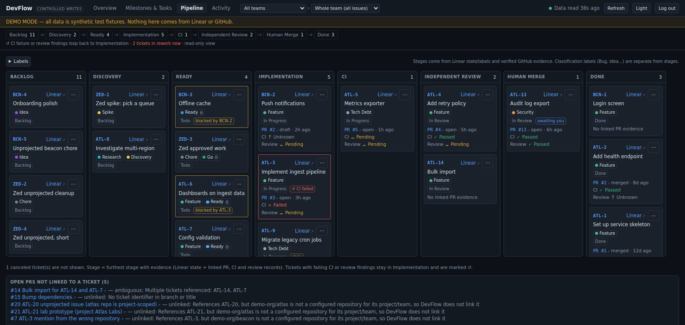
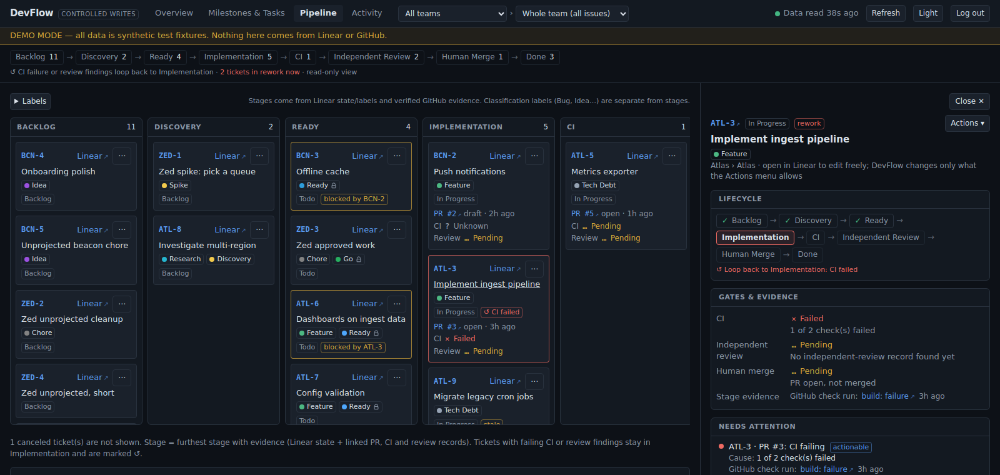

# DevFlow

Local-first engineering dashboard for Linear, GitHub, and AI-assisted development workflows.

DevFlow gives one person a consolidated view of tickets (Linear), pull requests, CI and review evidence (GitHub), and a lifecycle pipeline derived from both. It adds a small set of narrowly scoped Linear actions. It was built to make the *process* around AI-assisted development visible before automating any of it; see the article [Why I built the process before the automation](https://peter.logixforgeai.com/blog/process-before-automation).




*Screenshots use the built-in synthetic demo data. Nothing in them comes from a real Linear or GitHub account.*

## Authority boundaries

- **Linear is authoritative** for tickets, labels, milestones and workflow state.
- **GitHub is authoritative** for pull requests, CI and review state. DevFlow only reads GitHub.
- DevFlow provides consolidated visibility and a few scoped operations. It does not run agents, merge PRs, delete or bulk-edit issues, or write to GitHub.
- "Ready", "independent review" and "completion" are engineering workflow concepts shown in the UI. DevFlow does **not** enforce every ticket transition: status changes are sent to Linear, and Linear decides what is allowed.
- Consequential actions (for example *Approve for execution*) need explicit human confirmation in the UI. Nothing runs without a person pressing the button.

## Architecture

React + Vite + Tailwind frontend, Fastify backend, loopback-only (`127.0.0.1`, port 4317). Dashboard data is cached in memory; a local SQLite file stores authentication state only.

- `web/`: views, issue detail, action UI, prompt library.
- `server/linear.ts`, `server/github.ts`: read clients; upstream data is treated as untrusted and normalized.
- `server/scope.ts`, `server/actions.ts`, `server/linear-write.ts`: resolve write authorization from live issue scope, validate and serialize actions, and read results back from Linear. Three fixed mutations, separate write credential.
- `server/service.ts`, `server/snapshot.ts`: on-demand reads, caching, derived evidence. Missing evidence is shown as Unknown, never Passed.
- `server/auth.ts`, `server/app.ts`: single local admin, sessions, request guards, static serving.

There is no background polling. With no browser connected DevFlow makes no Linear or GitHub requests.

## Requirements

- Node.js **24.7+** (uses built-in `node:sqlite` and `crypto.argon2`) and npm.
- A POSIX shell (Linux, macOS, or WSL). The build scripts use `rm`.
- For real data: a Linear personal API key (Read) and a read-only GitHub fine-grained token. Not needed for the demo.

## Quick start: synthetic demo

```bash
npm ci
npm run build
npm run auth:setup   # one-time: choose a local admin password (15+ characters)
npm run demo         # open http://devflow.localhost:4317 and sign in
```

Demo mode serves labelled synthetic data and fake upstream services (including a fake Linear that accepts actions), makes no network calls, and does not read `.env`. It uses the same local auth store as normal mode unless `DEVFLOW_AUTH_DB` points elsewhere.

## Run with your own data

```bash
npm ci
cp .env.example .env && chmod 600 .env                 # add your own keys
cp devflow.config.example.json devflow.config.json     # replace the placeholder values
npm run build
npm run auth:setup
npm start                                              # http://devflow.localhost:4317
```

Configuration uses placeholder values in `devflow.config.example.json` (`ABC`, `your-org/your-repo`, an example vault path). Replace them. `.env` and `devflow.config.json` are git-ignored. Obsidian knowledge links are optional. The Linear **write** key is optional; without it every action is shown disabled. See [docs/REFERENCE.md](docs/REFERENCE.md) for credentials, scopes, config fields and behaviour details.

Startup is strict: missing config, missing build or an occupied port exits non-zero. `GET /api/healthz` and `/api/readyz` do not call upstreams, but they sit behind the authentication gate like every other API route (the public `/login` page is the unauthenticated "is it up" probe). The app answers only on host `devflow.localhost:<port>`; browsers resolve `*.localhost` to loopback themselves.

### Optional launchers

- `scripts/devflow-start.sh` / `scripts/devflow-stop.sh` (Linux/WSL; set `DEVFLOW_NO_BROWSER=1` to skip opening a browser). Logs go to `logs/devflow.log`.
- `windows/DevFlow.cmd` starts DevFlow inside WSL from Windows. It needs `DEVFLOW_WSL_PATH` (the checkout path inside WSL) and optionally `DEVFLOW_WSL_DISTRO`; see the comments in the file. It has not been tested on every Windows/WSL setup. Neither launcher is required.

## Develop and verify

```bash
npm test
npm run typecheck
npm run build
npm run audit     # production dependencies; needs npm registry access
npm audit         # including dev dependencies
```

`npm run dev:server` (tsx watch) and `npm run dev:web` (Vite on :5173; no sign-in page, so use `npm start` to exercise authentication).

Tests use synthetic upstream services. Some need a loopback socket and the `git` executable, so run them in a normal checkout. Passing synthetic tests does not establish compatibility with live Linear writes.

## Security model

- Loopback bind only; exact Host check; no HTTPS, so cookies are not `Secure`.
- One local admin; Argon2id password hash; opaque `HttpOnly; SameSite=Strict` session cookie (only a SHA-256 verifier is stored); 30-minute sliding inactivity timeout enforced server-side; login throttling.
- Everything except the sign-in page, its assets, `GET /api/auth/state` and `POST /api/auth/login` requires a session.
- The server accepts GET/HEAD, plus POST only under `/api/auth/` and `/api/actions/`. POSTs must be same-origin JSON with small body limits. Logout, touch and actions also require a session-bound CSRF token (HMAC key persisted in the auth database). Login requires neither an existing session nor a CSRF token.
- Linear read client sends queries only; the write client exposes exactly `issueAddLabel`, `issueRemoveLabel` and `issueUpdate` (state or milestone only). Actions re-read live Linear first and are serialized.
- Credentials stay server-side and are not logged or returned in errors.

Not covered: a compromised OS account that can read your credentials, the auth database or process memory; MFA; multi-user; HTTPS. These properties come from the code and the synthetic tests, not an independent security audit.

## Known limitations

- **Live-write evidence is limited.** The automated tests exercise every action against an in-memory fake Linear only; no test or recorded verification in this repository sends a write to real Linear. The author reports using DevFlow against a real Linear workspace to read issues and to update labels and statuses. That is operational use by the author, not independently reproducible evidence, and it is not documented per operation. Milestone changes and Approve/Revoke have no reported live use. Live Linear compatibility of every write path should be treated as unverified.
- **Write failure handling differs by action.** Status, Approve and Revoke re-read Linear after a failed or ambiguous write and report the observed (or unknown) state. Label and milestone changes read back only after their writes return; if a write request itself throws, they report a generic failure without a readback, and a multi-label change sends one mutation per label, so it can be partially applied. Nothing is rolled back automatically. Check the issue in Linear after any reported failure.
- GitHub: newest 100 PRs per repo; full evidence for open PRs and PRs updated in the last 14 days (max 30); up to 300 items per resource. Check-run details are shown as Unavailable with the documented token permissions.
- Descriptions over 10,000 characters are truncated; Linear history shows the last 5 state transitions per issue.
- `node:sqlite` and `crypto.argon2` may print experimental warnings depending on the Node release.
- Closing the browser tab does not stop the server.

## Status and license

Early (0.1.0), published as a working engineering project to inspect, run, modify and reuse. No support or compatibility guarantees. `private: true` in `package.json` only prevents accidental npm publication.

Copyright (c) 2026 Peter Stearns. Licensed under the [MIT License](LICENSE). Third-party dependencies keep their own licenses.
